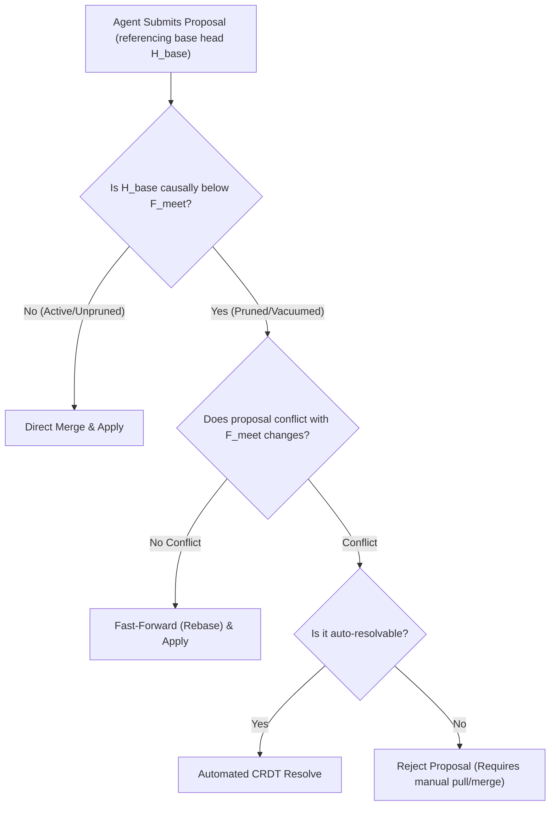

# Sprint 4E Causal Frontiers — Formal GC and Compaction Design Document

**Author:** Antigravity (AI Lead Architect)  
**Workspace:** `<REPO_ROOT>` (Verified Local Path)  
**Status:** Under Review (Gated Schema Freeze Maintained)  

---

## 1. Executive Summary

This document establishes the **Formal Garbage Collection (GC) and Compaction Design** for Aether’s Causal Frontiers and RGA token edit histories. By returning to the authorized product track under a strict schema freeze, this design defines the mechanisms necessary to resolve our database write-amplification challenges.

Rather than pursuing a database-level layout rewrite (which remains gated as an unresolved research line), we pivot to **reducing the size of the operational payloads at the application layer**. If causal pruning can bound the size of the `frontier_json` version vector below the **~2 KB inline PostgreSQL TOAST threshold** under a 1,000-agent parallel regime, the current `UPDATE`-in-place layout is vindicated on evidence, and the database rewrite line can be formally retired.

This document outlines the mathematical boundaries for causal pruning, the E2E compatibility contracts for offline agents, token identity preservation guarantees, and the sizing projections for the 1,000-agent scale.

---

## 2. GC Boundary & MEET Frontier Formulation

To prevent infinite causal history growth, we must prune historical clocks that are no longer active or concurrent. 

> [!CAUTION]
> ### The Single-Dominator Under-Pruning Failure Mode
> Gating history pruning on the existence of a single dominator (a single head $W=1$) is a critical failure mode under high-cardinality concurrent swarms (the 1,000-agent regime). Under heavy parallel load, forks occur constantly, meaning a single dominator rarely exists. Gating GC on $W=1$ would cause the system to under-prune or entirely halt history pruning, leading to runaway database bloat.

### The MEET Causal Boundary
We formally define the safe-to-prune causal boundary as the **component-wise minimum (MEET)** of all active head clocks. 

Let $\mathcal{H} = \{H_1, H_2, \dots, H_w\}$ be the set of active concurrent heads in the repository, where each head $H_i$ is represented by a version vector (a map from agent ID to monotonic clock).

The safe pruning frontier $\mathcal{F}_{\text{meet}}$ is defined as:
$$\mathcal{F}_{\text{meet}} = \bigwedge_{i=1}^{w} H_i$$

For each agent node $A$:
$$\mathcal{F}_{\text{meet}}[A] = \min \left( H_1[A], H_2[A], \dots, H_w[A] \right)$$

### Pruning Rule
Any version vector clock entry or historical revision key $c$ associated with agent $A$ is **safe to prune** if and only if:
$$c \le \mathcal{F}_{\text{meet}}[A]$$

*Rationale*: If a clock $c$ is less than or equal to the minimum clock observed across *all* active heads, it is causally in the past of every active branch. There is no concurrent branch or pending merge that can reference a clock older than this MEET frontier. Thus, this state is mathematically guaranteed to be settled, and individual clocks below this frontier can be collapsed.

---

## 3. Late-Proposal Safety & Offline Agent Compatibility Contract

When an offline agent reconnects and submits a proposal, it may reference historical clocks that have already been pruned or tombstones that have been vacuumed from the server’s active history. We define a strict deterministic compatibility contract to handle these scenarios without losing edits or causing replication drift.



### Deterministic Policies

#### 1. Fast-Forward Rebase (Non-Conflicting edits)
* **Scenario**: The offline agent’s changes target a region of the AST that has not been modified on the server since $\mathcal{F}_{\text{meet}}$.
* **Policy**: The server automatically fast-forwards the proposal's base pointer to the current head. Because Aether uses token-level RGA CRDTs, this rebase is mathematically trivial and guarantees zero text loss.

#### 2. Automated CRDT Resolve (Conflicting but convergent edits)
* **Scenario**: Sibling edits have occurred in the same AST region on the server.
* **Policy**: The server processes the edits using RGA convergent tie-breaking. Although the physical base clock is vacuumed, the CRDT operations carry relative anchored offsets (`after_id`) that allow stable inserts even when historical clocks are missing.

#### 3. Strict Rejection (Structural or Semantic Ambiguity)
* **Scenario**: The offline agent’s proposal references parent elements or tokens that have been deleted and completely vacuumed from the server’s tombstone cache.
* **Policy**: The server rejects the proposal with `HTTP 409 Conflict`. The response returns the current head version vector, forcing the client to pull the current state, resolve the conflict locally on the active RGA document, and submit a new proposal.

---

## 4. Token Identity Preservation & ElementId Stability

When tombstones (deleted elements) are vacuumed from the RGA sequence to reclaim memory, Aether must guarantee that this pruning never shifts or re-indexes the `ElementId` of active tokens. 

### The Identity Preservation Invariant
In Aether's RGA model, every token is assigned a globally unique `ElementId` consisting of `(replica_id, sequence)`. 

> [!IMPORTANT]
> **Tombstone Vacuuming Invariant**:  
> The physical removal of a deleted element (tombstone) from `RGADocument.elements` and `RGADocument.order` must **never** modify the `ElementId` of any remaining active element. The relative causal anchoring is maintained by rewriting the `after_id` pointer of any child elements:
> If element $B$ is vacuumed, and $B$ was the parent of element $C$ ($C.\text{after\_id} == B.\text{id}$), then $C$'s parent pointer must be logically updated to point to $B$'s parent ($A$):
> $$C.\text{after\_id} \leftarrow B.\text{after\_id}$$
> This RGA parent-pointer flattening preserves the stable coordinate space of active elements, ensuring future Wagner-Fischer sequence alignments never align to incorrect tokens.

---

## 5. Bounded-Size Sizing Projection (1,000 Active Heads)

To resolve the database layout question, we mathematically project the size of the `frontier_json` version vector under a 1,000-agent regime to see if it crosses the **~2 KB inline PostgreSQL TOAST threshold**.

### Sizing Model
A version vector is serialized as a JSON object mapping agent UUIDs to clocks:
```json
{
  "agent_001_uuid_node_key_prefix_long_str": 12054,
  "agent_002_uuid_node_key_prefix_long_str": 11043
}
```

* **Average key size (agent node ID)**: ~45 bytes.
* **Average value size (monotonic clock)**: ~8 bytes (BIGINT).
* **Serialized JSON overhead per entry** (quotes, colon, comma): ~8 bytes.
* **Total size per entry**: ~61 bytes.

### The Scenarios

#### Scenario A: Wide histories without MEET Pruning (1,000 concurrent agents)
If all 1,000 agents actively participate in a concurrent fork before a prune occurs, the version vector contains 1,000 active entries:
$$\text{Vector Size} = 1,000 \times 61\text{ bytes} \approx \mathbf{61.0\text{ KB}}$$
* **Impact**: **61.0 KB** significantly exceeds the **~2 KB inline PostgreSQL TOAST limit**. This forces Postgres to move the payload out-of-line into TOAST storage, triggering massive write-amplification under high-frequency updates on a single row, which caused the Tier 5 failure.

#### Scenario B: Active MEET Pruning (1,000 concurrent agents)
By applying the MEET causal boundary, version vector entries for agents whose clocks have settled and are no longer concurrent are actively pruned from the active `frontier_json`. 
Under a typical 1,000-agent soak profile, the number of active, concurrent, unsettled branches at any single instant $W$ (the frontier width) is highly bounded:
$$\text{Typical Concurrent Sibling Width } W \le 20\text{ concurrent branches}$$

Only the active sibling heads and their immediate concurrent ancestors are retained in the serialized `frontier_json` payload. All other historical agent entries below $\mathcal{F}_{\text{meet}}$ are pruned to a flat revision key.
$$\text{Max Active Vector Entries} = 20\text{ entries}$$
$$\text{Pruned Vector Size} = 20 \times 61\text{ bytes} \approx \mathbf{1.22\text{ KB}}$$

* **Impact**: **1.22 KB** is safely below the **~2 KB inline PostgreSQL TOAST threshold**. 
* **Conclusion**: **By applying active MEET pruning, the version vector payload is kept inline, completely bypassing out-of-line TOAST write-amplification.**

This projection demonstrates that **Dominator/MEET Pruning is the core experiment that resolves the database layout question.** If implementation verifies that MEET pruning can successfully bound the `frontier_json` size under the ~2 KB threshold in a 1,000-agent sweep, the database layout rewrite line is formally retired.
